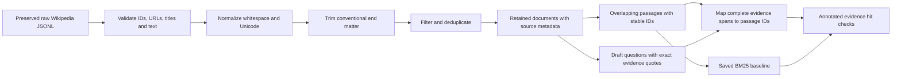

# Wikipedia dataset pipeline

This is the runnable dataset preparation pilot for the presentation on **8 November 2026**. It prepares passages and draft evidence labels for a later offline RAG system. The completed demo uses lexical BM25 retrieval and runs with Python networking blocked.

## Source-only repository checkout

Git tracks the Python implementation, tests, requirements, this README and the PowerShell launcher. Datasets, evaluation labels, saved indexes, model files, reports and presentation artifacts stay local and are ignored. They are not downloaded automatically when the code runs.

With Python 3.10 or newer, prepare your own local English Wikipedia JSONL file containing `id`, `url`, `title` and `text` fields. For preprocessing without evaluation labels:

```powershell
python -X utf8 dataset_pipeline.py build --source "C:\path\to\articles.jsonl" --skip-evaluation
python -X utf8 dataset_pipeline.py verify
python -X utf8 retrieval_baseline.py build
python -X utf8 retrieval_baseline.py query --question "Your question here"
python -X utf8 -m unittest discover -s tests -v
```

The complete presentation demo and `offline_check.py` additionally require the local draft question file and previously built data/index artifacts described below. To rebuild that version, omit `--skip-evaluation` and provide `--questions "C:\path\to\questions.json"`. The measurements below describe the local pilot run, not data distributed in Git.

## Verified local output

| Item | Current measurement |
| --- | --- |
| Local source | 200 English Wikipedia articles, 6,225,372 bytes |
| Source quality | 200 unique article IDs and 200 unique raw texts, no blank texts |
| Retained articles | 193 |
| Rejected articles | 7: six disambiguation titles and two short articles, with one overlap |
| End-matter cleanup | 188 source articles trimmed, 26,295 whitespace words removed |
| Passage settings | 200 whitespace words, 40-word overlap, within each article |
| Passages | 5,891, with no identical passage texts |
| Draft evaluation | 30 questions: 10 development and 20 test |
| Evidence labels | All 26 answerable questions map to complete supporting spans |
| Unsupported questions | Four synthetic questions about unpublished project information |
| Split control | No source article appears in both the development and test question sets |
| Offline scope | Dataset rebuild, checksums, saved lexical index reload, query and draft metric computation |

The source is a general-topic early Wikipedia slice. Of 193 retained titles, 179 begin with A. It is not a random sample, a dedicated astronomy corpus, or a 500-article collection. `--max-articles 500` is a cap: it retains only articles actually present. The existing project materials identify `wikimedia/wikipedia`, `20231101.en`; the local JSONL does not independently encode or prove the dump revision.

## Data flow



Evaluation answers and labels live in `evaluation/`. They never become indexed passage text. All retained source articles, including those supporting test questions, belong in the retrieval corpus: the question split controls tuning and evaluation, rather than hiding answer documents from retrieval.

## Preprocessing decisions

1. Preserve the raw file byte for byte and record its SHA-256.
2. Require `id`, `url`, `title` and `text`, with valid types. Fail on malformed JSON, missing fields or conflicting texts under one ID.
3. Normalize Unicode to NFC, line endings and repeated whitespace. Preserve case, scientific symbols, numbers, punctuation and paragraph breaks. This cannot restore equations already missing from the source extraction.
4. Remove text from a standalone `References`, `External links`, `Further reading` or `Bibliography` heading only after at least 80 preceding words. Keep the original snapshot for review. Other lists and extraction artifacts can remain.
5. Remove articles with fewer than 80 words and titles ending in `(disambiguation)`. Record every rejection. These pilot rules can exclude useful short pages and do not identify every disambiguation page.
6. Deduplicate exact normalized article texts and IDs. This does not detect all near duplicates.
7. Create word windows without crossing article boundaries. Preserve the article title, URL, original ID, exact character offsets, word offsets and a stable passage ID. These word counts are independent of any generator tokenizer.
8. Map a question's exact evidence quote to every passage that contains the complete quote. Reject development/test article overlap. Human reviewers still need to check question quality and label equivalent supporting passages.

The 200/40 word settings are an initial inspectable choice. No chunk-size optimization or claim of superiority is made. Before using Flan-T5-small or another generator, check passage length with that generator's tokenizer and pack instructions, question, source labels and evidence within its input budget.

## Presentation demonstration

From the workspace root:

```powershell
& .\offline_rag_deep_learning_project\run_demo.ps1
```

The demonstration verifies shipped artifacts, rebuilds the dataset in a temporary directory with Python socket connections and DNS blocked, reconstructs and reloads a lexical index, compares it with the shipped index, and retrieves passages for:

> What was the name of the Apollo 11 lunar module?

The top passage is from **Apollo 11** and contains **Eagle**. The output is retrieved evidence, not a generated answer. The saved lexical index is self-contained; it stores the corpus and fixed BM25 settings and reconstructs inverted postings in memory when loaded.

To ask another question:

```powershell
& .\offline_rag_deep_learning_project\run_demo.ps1 -Question "What is the atomic number of argon?"
```

For a different Python installation:

```powershell
& .\offline_rag_deep_learning_project\run_demo.ps1 -Python "C:\path\to\python.exe"
```

Use PowerShell's terminal output for the demo and the presentation file for the explanation. No internet, GPU, embedding model or generator is needed for these completed stages.

## Offline handoff package

`output/package/Wikipedia_Dataset_Pilot.zip` contains the selected pilot's source snapshot, processed articles and passages, evaluation drafts, saved lexical index, Python scripts, reports and presentation files. It excludes unrelated downloaded datasets, model weights and the Python environment. An installed Python 3.10 or newer interpreter is required.

Extract the ZIP and run `run_demo.ps1 -Python "C:\path\to\python.exe"` from the extracted folder. The package check extracts to a temporary directory and runs the offline verification there, so it also checks independence from the original dataset location.

To recreate and verify the ZIP after making changes, run `package_pilot.py` with the same Python interpreter. Per-file SHA-256 values are stored in `bundle_manifest.json` inside the ZIP. `reports/package_verification.json` records the ZIP checksum and actual verification result outside the ZIP.

## Full rebuild and checks

From this project directory, using the existing environment:

```powershell
$pilotPython = "..\dl_project\.venv\Scripts\python.exe"
& $pilotPython -X utf8 dataset_pipeline.py build --source data/raw/wikipedia_source.jsonl
& $pilotPython -X utf8 retrieval_baseline.py build
& $pilotPython -X utf8 retrieval_baseline.py evaluate
& $pilotPython -X utf8 offline_check.py
& $pilotPython -X utf8 -m unittest discover -s tests -v
```

If any command exits nonzero, stop and inspect its error before continuing. The generated `data/manifest.json` records dataset and evaluation artifact checksums. The offline check also validates the saved index against the current passage corpus. Rebuild the index after changing preprocessing or source data.

To process a larger local JSONL file with the same schema:

```powershell
& $pilotPython -X utf8 dataset_pipeline.py build --source "C:\path\to\wikipedia_articles.jsonl" --max-articles 500
```

This command changes the pilot and its evidence mapping. Review the new retained corpus, remake questions that lose evidence, rebuild the index, and rerun checks before using new results. Acquire a reproducible, topic-stratified source collection before claiming a representative 500-article astronomy pilot.

## Exploratory retrieval results

The current BM25 baseline retrieves the selected annotated evidence at these rates across the 26 answerable draft questions:

| Metric | Hits | Rate |
| --- | --- | --- |
| Annotated evidence Hit@1 | 14/26 | 53.8% |
| Annotated evidence Hit@3 | 20/26 | 76.9% |
| Annotated evidence Hit@5 | 22/26 | 84.6% |

These figures are a smoke test over a draft set whose splits have already been inspected. They are not final held-out scores, semantic evidence recall, answer accuracy, faithfulness or hallucination rates. Evidence quotes mainly come from article leads and do not exhaust all valid supporting passages. Human review and a new frozen final test protocol are still required.

Two different issues appear in the current misses. The ampere question retrieves a passage about a physical quantity from the Albert Einstein article, illustrating lexical mismatch. The astatine question retrieves an alternate sentence explicitly naming astatine-210, but misses the particular lead span currently labeled. That second case is an annotation gap, so it must not be counted as a demonstrated semantic retrieval failure. The abacus question retrieves relevant-topic passages without reaching the annotated counting-frame definition in the first five results.

The four synthetic unsupported questions are deliberately easy out-of-corpus examples. BM25 still returns passages for their shared words. Retrieval scores alone cannot decide answerability. A later generator and abstention policy need a separate evaluation.

## Five-minute speaking outline

- **Opening, 30 seconds:** We inspected the downloaded data before selecting a model. The implemented pilot uses the 200 Wikipedia articles already available locally.
- **Data quality, 45 seconds:** Explain the mixed topics and A-title bias. Show the seven logged exclusions and the preserved raw source.
- **Preprocessing, 60 seconds:** Explain conservative normalization, end-matter removal and exact deduplication. Case and scientific symbols remain in the source text.
- **Passages, 45 seconds:** Explain 200-word windows and 40-word overlap, with source URL and offsets. Smaller passages make evidence retrieval and inspection practical.
- **Evaluation preparation, 45 seconds:** Show one question, reference answer, exact evidence quote and mapped passage ID. Explain 10 development/20 test questions and pending human review.
- **Live demonstration, 45 seconds:** Run `run_demo.ps1`, show zero network attempts, then read the Apollo 11 evidence containing Eagle.
- **Results and next steps, 30 seconds:** State the exploratory annotated-evidence result and its limits. Dense retrieval, prompt packing and generation come next.

## Likely questions

**Why use 200 rather than 500 articles?** The local source contains 200. We established the pipeline on real available data before expanding it. A larger, balanced source sample is the next data acquisition step.

**Why remove stop words or lowercase?** We preserve those in the stored documents and passages. Only the lexical search tokenizer casefolds and ignores a fixed stop-word list. A later embedding model should receive the source text using its documented preprocessing.

**Why overlap passages?** A fact can cross a window boundary. The overlap gives some boundary facts another complete window, but long evidence spans can still cross windows. The mapping step detects those cases.

**Why are test-source articles in the index?** RAG must retrieve the evidence needed to answer test questions. We separate question sets and keep labels out of indexed text.

**Have you trained a new deep learning model?** This stage prepares data for a RAG project. It does not train an embedding model or generator. The separate SQuAD model in `dl_project` performs a different extractive task.

**What exactly runs offline?** The implemented dataset rebuild, artifact verification, lexical index reload, retrieval and draft evidence metric calculation. Future model inference needs its own offline validation.

## Remaining RAG work

1. Agree on the domain and collect a balanced source subset, preserving source revision and attribution.
2. Human-review questions and supporting evidence, add harder unsupported and paraphrased questions, and freeze a final test set before tuning.
3. Download and save a chosen embedding model and generator during connected setup, then load them from local paths.
4. Generate normalized dense passage embeddings, save vectors with passage-ID mappings, and compare dense retrieval with BM25 on development questions.
5. Pack retrieved passages within the generator's actual tokenizer budget, with source labels and instructions to abstain when evidence is insufficient.
6. Generate answers and evaluate retrieval separately from semantic correctness, support, answer coverage and false answers on unsupported questions.
7. Analyze failures and package all required model files. Verify a complete end-to-end run with networking blocked.

The existing proposals mention MiniLM and Flan-T5-small. Their presence in a proposal does not mean their artifacts are installed or their performance has been measured.

## Files

| Path | Contents |
| --- | --- |
| `data/raw/wikipedia_source.jsonl` | Preserved local source |
| `data/processed/documents.jsonl` | Clean retained articles and metadata |
| `data/processed/chunks.jsonl` | Passages with stable IDs and exact offsets |
| `data/processed/rejected_articles.jsonl` | Every rejected article and reason |
| `data/manifest.json` | Settings and dataset/evaluation checksums |
| `evaluation/wikipedia_questions_draft.json` | Questions, reference answers and selected exact evidence quotes |
| `evaluation/questions_mapped.json` | Draft questions with complete supporting passage IDs |
| `data/index/bm25.json` | Self-contained saved lexical index representation |
| `reports/dataset_report.json` | Measured quality and size statistics |
| `reports/retrieval_smoke_test.json` | Per-question exploratory annotated-evidence checks |
| `reports/offline_verification.json` | Actual network-blocked run result and its scope |
| `reports/code_audit.md` | Existing application gaps and repairs |
| `reports/materials_audit.md` | Contradictions across earlier project proposals |
| `reports/existing_datasets_inventory.json` | Recursive file inventory for 19 dataset directories |

The MIT mechanics question file and slides remain as an alternative proposal and do not score this Wikipedia corpus. Original downloaded datasets remain intact.

## Source and attribution

Wikipedia contributors authored the source articles. Each retained article and passage preserves its English Wikipedia URL. The source snapshot remains available beside the derived text. Changes consist of normalization, removal of conventional end matter, article filtering and passage segmentation.

The [Wikimedia Wikipedia dataset card](https://huggingface.co/datasets/wikimedia/wikipedia) lists CC BY-SA 3.0 and GFDL. Preserve its notices and article attribution when sharing source-derived artifacts. The [Wikimedia Terms of Use](https://foundation.wikimedia.org/wiki/Policy:Terms_of_Use) provide the source reuse and attribution terms. These links were checked on 7 November 2026. The local file's exact upstream revision remains unverified.
